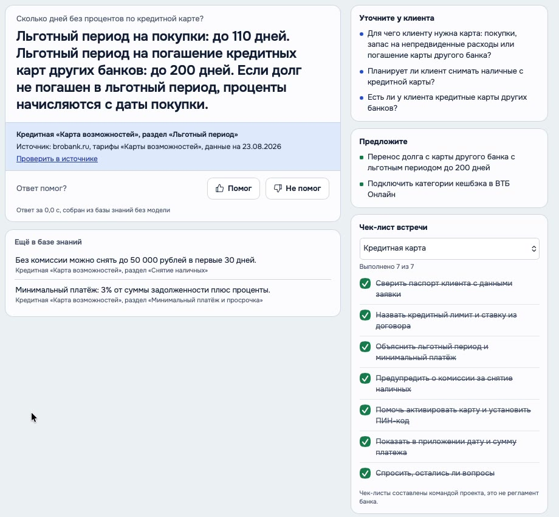
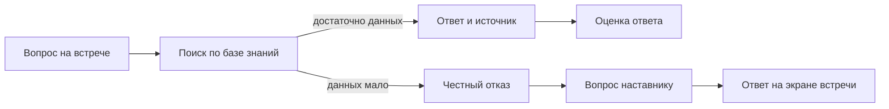

# WПомощник

**Помощник выездного менеджера на встрече с клиентом.** Он проводит по шагам встречи, отвечает по базе знаний с указанием источника и передаёт вопросы без ответа наставнику.

> **Статус:** демонстрационный MVP первого спринта. Сценарии помечены как черновики; условия продуктов перед использованием нужно сверять с действующими тарифами и регламентами банка.



## Что уже работает

| На встрече | Для команды |
| --- | --- |
| Пошаговые сценарии для дебетовой карты, кредитной карты и перевода пенсии | Очередь вопросов наставникам и ответ на экране сотрудника |
| Поиск ответа по базе знаний с источником, датой и ссылкой | Журнал встреч, вопросов, оценок ответа и пропущенных пунктов |
| Подсказки «Уточните» и «Предложите», чек-листы | Аналитика частых вопросов и пробелов базы знаний |
| Текстовый и браузерный голосовой ввод | Режим без модели и подключение Ollama |

## Быстрый запуск

Нужен **Python 3.10+**. Для первого знакомства Ollama не требуется.

```bash
git clone https://github.com/himasl/WWTeam_-.git
cd WWTeam_-
python3 -m venv .venv
source .venv/bin/activate
pip install -r requirements.txt
LLM=off uvicorn app.main:app --host 127.0.0.1 --port 8000
```

Откройте [экран встречи](http://127.0.0.1:8000/). Другие страницы: [вопросы коллег](http://127.0.0.1:8000/colleagues), [аналитика](http://127.0.0.1:8000/stats), [документация API](http://127.0.0.1:8000/docs). Состояние сервера доступно по `GET /api/health`.

### Что показать в демо

1. Нажмите карточку **«Кредитная карта»**: появится сценарий встречи с шагами и проверками.
2. Спросите: **«Сколько дней без процентов по кредитной карте?»**. Под ответом будут источник и дата данных.
3. Откройте чек-лист кредитной карты и отметьте выполненный пункт.
4. Спросите: **«Какие условия по ипотеке?»**. База знаний не содержит ипотеку, поэтому помощник предложит **«Спросить коллег»**.
5. Выберите сотрудника через **«Кто вы?»** и откройте **«Коллеги»**, чтобы увидеть вопрос в очереди.

## Как устроен ответ



Поиск в [`app/kb.py`](app/kb.py) использует BM25 и русскую морфологию. При низкой уверенности помощник не придумывает ответ. Если включена модель, она формулирует ответ только по найденным разделам. При недоступности модели сервер использует факты из базы знаний, если уверенности поиска достаточно. Источники хранятся вместе с материалами в [`kb/`](kb/).

Архитектура и границы пилота подробно описаны в [`docs/ARCHITECTURE.md`](docs/ARCHITECTURE.md), результаты первого спринта — в [`docs/sprint1_submission.md`](docs/sprint1_submission.md).

## Настройки

Значения можно задать переменными окружения или в `.env` по образцу [`.env.example`](.env.example). Переменная окружения имеет приоритет над файлом. `.env` и база SQLite не входят в репозиторий.

| Переменная | Назначение | По умолчанию |
| --- | --- | --- |
| `LLM` | `on` — использовать Ollama, `off` — только база знаний | `on` |
| `OLLAMA_URL` | Адрес локального или облачного Ollama | `http://localhost:11434` |
| `OLLAMA_MODEL` | Имя модели | `gpt-oss:120b-cloud` |
| `OLLAMA_API_KEY` | Ключ для облачного Ollama, если нужен | пусто |
| `OLLAMA_THINK` | `false` отключает режим размышления у совместимых моделей | `false` |
| `OLLAMA_TIMEOUT` | Тайм-аут ответа модели, секунды | `40` |
| `DB_PATH` | Путь к SQLite-журналу | `data/log.db` |
| `COVER_HIGH`, `COVER_LOW` | Пороги уверенности поиска | `0.6`, `0.3` |
| `MAX_QUESTION` | Максимальная длина вопроса | `500` |

Пример запуска с локальной моделью:

```bash
cp .env.example .env
# Укажите в .env модель, которая есть в `ollama list`.
uvicorn app.main:app --host 127.0.0.1 --port 8000
```

Для облачного Ollama задайте `OLLAMA_URL`, `OLLAMA_MODEL` и `OLLAMA_API_KEY`. Если модель недоступна, ответ по базе знаний остаётся доступен. Текущий режим отображается под ответом.

## Структура проекта

| Путь | Содержимое |
| --- | --- |
| [`app/`](app/) | FastAPI, поиск, сценарии, Ollama, SQLite |
| [`web/`](web/) | Интерфейс встречи, наставника и аналитики |
| [`kb/`](kb/) | Статьи, каталог, чек-листы, словарь терминов |
| [`scenarios/`](scenarios/) | JSON-сценарии встреч и правила подбора |
| [`tests/`](tests/) | Проверки поиска, API, сценариев и встреч |
| [`docs/`](docs/) | Архитектура, аналитика отзывов, план внедрения |

### Как добавить материал

Создайте статью в `kb/` по образцу существующих: в заголовке укажите продукт, тему, источник, ссылку и дату, затем добавьте короткие факты по разделам. Для нового сценария создайте JSON в `scenarios/`, проверьте его командой `python -m app.scenarios` и перезапустите сервер. Описание формата шагов и правил есть в существующих JSON-файлах и [`app/scenarios.py`](app/scenarios.py).

## Проверки

```bash
python -m app.scenarios
python tests/check_search.py
python tests/check_api.py
python tests/check_meeting.py
```

Эти проверки работают без настоящей модели: `check_api.py` подменяет ответы Ollama. Для отдельной проверки качества **на запущенном сервере с настоящей моделью** используйте `python tests/check_quality.py http://127.0.0.1:8000`. Результат такого прогона нельзя заменять результатами проверок с подменённой моделью.

## Ограничения MVP

- Входа по учётной записи и разграничения прав пока нет: имя и роль выбираются в интерфейсе, журнал общий. Это не готовая схема доступа для банка.
- База знаний использует открытые источники. Часть условий взята из сторонних обзоров; перед показом клиенту их нужно сверить с официальными тарифами.
- Чек-листы и правила предложения продуктов составлены командой проекта и **не являются регламентом банка**.
- Голосовой ввод зависит от возможностей браузера. Без него текстовый ввод работает как обычно.
- Анализ [248 открытых отзывов](docs/otzyvy/README.md) относится к похожей работе представителей другого банка и не доказывает частоту проблем у сотрудников ВТБ. Интервью и измерение эффекта пилота ещё нужны.

Проект и его материалы предназначены для демонстрации и проверки гипотезы, а не для консультации клиентов по действующим условиям.
