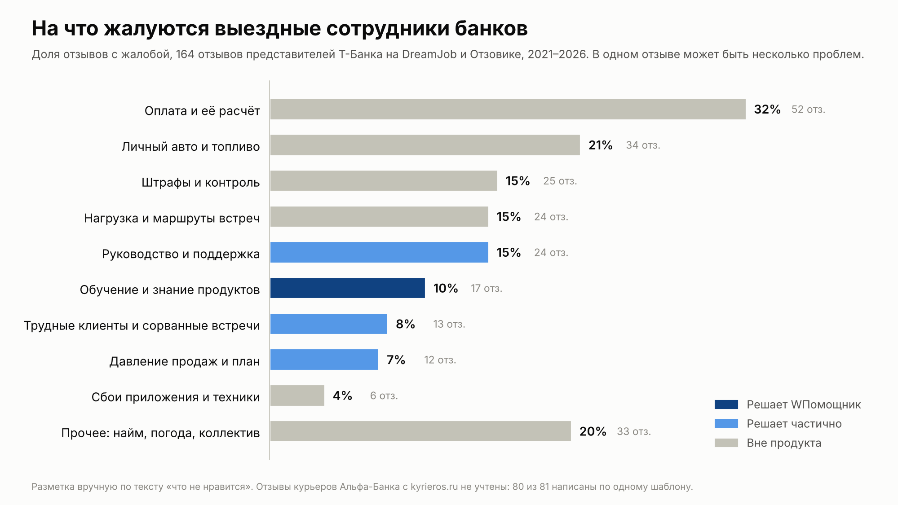

# На что жалуются выездные сотрудники банков

Анализ открытых отзывов сотрудников, октябрь 2026. Интервью с сотрудниками ВТБ провести не удалось, поэтому смотрим на ближайший аналог: представителей Т-Банка, которые так же ездят к клиентам с картами и документами.

## Что собрали

| Источник | Кто пишет | Отзывов | Учтено |
|---|---|---|---|
| DreamJob, вакансия «Банковский представитель» | представители Т-Банка, 2021–2026 | 127 | да |
| Отзовик, «Представитель банка Тинькофф» | представители Т-Банка, 2021–2026 | 40 | да |
| kyrieros.ru, Альфа-Банк | курьеры и представители | 81 | нет |

Отзывы с kyrieros.ru в доли не вошли: 80 из 81 написаны по одному шаблону («Доставляю карты… По деньгам чувствую себя уверенно…») и похожи на рекламу вакансии. Они есть в таблице с пометкой «похоже на шаблон».

## Как размечали

1. Брали только часть отзыва про недостатки: «Что можно улучшить?» на DreamJob, заголовок, начало текста и «Недостатки» на Отзовике.
2. Каждый отзыв прочитан целиком и отмечен одной или несколькими проблемами из десяти. Разметка в `labels.txt`, номер строки совпадает с колонкой «№» в таблице.
3. Доля = отзывы с этой проблемой / отзывы, где есть хоть одна жалоба (164 из 167). Сумма больше 100%, потому что в одном отзыве бывает несколько проблем.
4. Для каждой проблемы отметили, решает ли её WПомощник: да, частично или нет.

Пересчитать: `python3 analyze.py && python3 chart.py`.

## Результаты

| Проблема | Отзывов | Доля | WПомощник |
|---|---|---|---|
| Оплата и её расчёт | 52 | 32% | нет |
| Личный авто и топливо | 34 | 21% | нет |
| Прочее: найм, погода, коллектив | 33 | 20% | нет |
| Штрафы и контроль | 25 | 15% | нет |
| Нагрузка и маршруты встреч | 24 | 15% | нет |
| Руководство и поддержка | 24 | 15% | частично |
| Обучение и знание продуктов | 17 | 10% | да |
| Трудные клиенты и сорванные встречи | 13 | 8% | частично |
| Давление продаж и план | 12 | 7% | частично |
| Сбои приложения и техники | 6 | 4% | нет |

## Что из этого следует

- Чаще всего жалуются на деньги, машину и штрафы. Это вопросы оплаты и организации труда, ИТ-помощник их не решает, и мы этого не обещаем.
- Каждый десятый отзыв с жалобой говорит о коротком обучении и нехватке знаний: «Обучение короткое, за него нужно впитать целую кучу информации», «Вас просто бросят в поле как котенка», «Часто меняются условия по разным услугам, нужно это все отслеживать», «засыпали сложными вопросами по инвестированию». Это прямая задача WПомощника: подсказки по шагам встречи и ответы из базы знаний.
- Ещё 15% жалуются на руководство и поддержку: «сотрудники вынуждены сами выкручиваться», «поддержка не на вашей стороне». Кнопка «Спросить коллег» и экран наставника закрывают часть этой боли.
- Вместе проблемы, которые помощник решает полностью или частично, есть в 35% отзывов с жалобами.
- Шесть сотрудников в положительной части отзыва сами называют наставника причиной, по которой удалось освоиться: «повезло с наставником», «он много подсказал дельного». Ещё один пишет, что спасли коллеги, а один жалуется, что наставник толком не обучил. Хороший наставник сейчас дело везения. WПомощник делает его знания доступными каждому новичку на каждой встрече.

## Ограничения

- Это отзывы Т-Банка, а не ВТБ. Работа похожа, но процессы банков различаются.
- На сайты отзывов чаще пишут недовольные и уволившиеся, поэтому доли показывают структуру жалоб, а не то, как часто проблема встречается у всех сотрудников.
- Разметку делал один человек. Перед защитой стоит перепроверить случайные 20–30 строк.

## Файлы

- `reviews_labeled.csv` — все 248 отзывов с разметкой, открывается в Excel.
- `reviews_raw.csv` — те же отзывы без разметки.
- `labels.txt` — разметка по номерам.
- `shares.csv`, `itogi.json` — посчитанные доли.
- `zhaloby.png` — график для презентации.

## Источники

- https://dreamjob.ru/employers/25607/vacancy-bankovskiy-predstavitel-
- https://otzovik.com/reviews/predstavitel_banka_tinkoff/
- https://kyrieros.ru/companies/alfa-bank/reviews/
